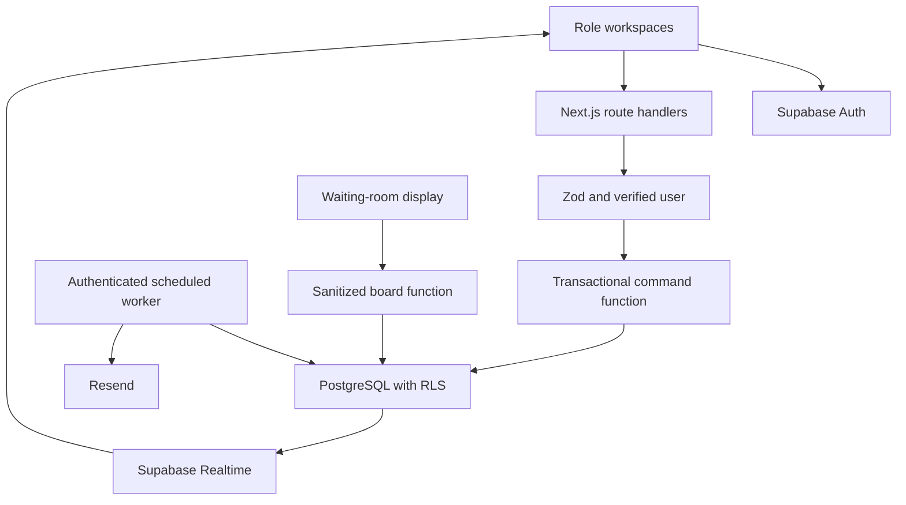
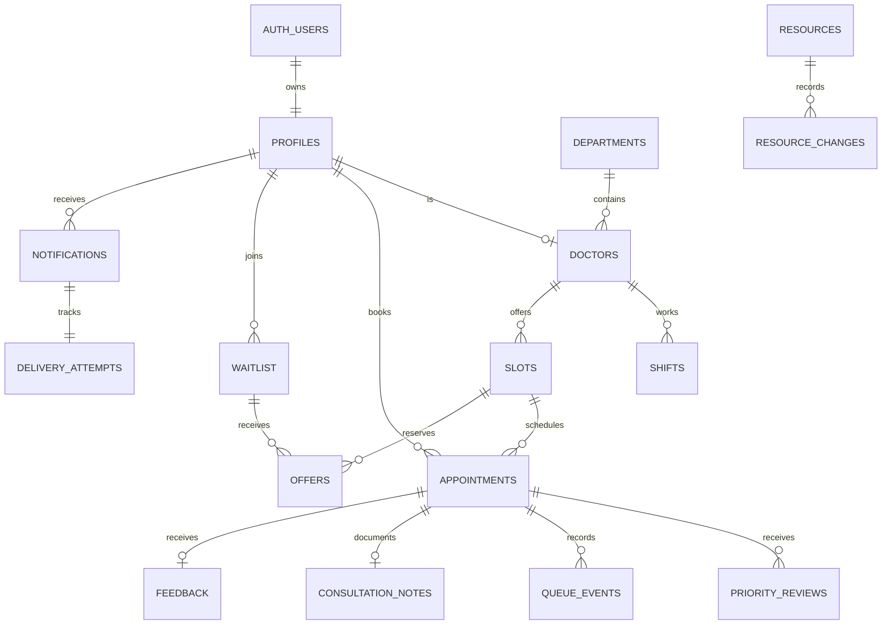

# Architecture

CareFlow is an original Next.js App Router project. The supplied Sites preview uses the maintained Vinext/Cloudflare adapter; standard Next.js commands are also included for Node/Vercel deployment. Supabase is the operational database and identity provider. The unconfigured preview offers a separate browser-local synthetic demonstration.

## Relationships

Vitals are an appointment JSON object rather than a separate table; clinical reviews, notes and transition events are separate. Audit events store action identifiers, not symptoms or note contents. Walk-ins have nullable patient IDs and cannot use self-service until a future account-linking feature is added.

## Permission matrix

| Operation                 | Patient               | Reception/nurse      | Doctor            | Admin                |
| ------------------------- | --------------------- | -------------------- | ----------------- | -------------------- |
| Read appointments         | Own                   | Assigned department  | Assigned doctor   | All                  |
| Book/reschedule           | Own                   | Walk-in registration | No                | Walk-in registration |
| Check-in                  | No                    | Department           | No                | All                  |
| Review priority           | No                    | Department           | Assigned patients | All                  |
| Call/start/complete       | No                    | No                   | Own queue         | No                   |
| Read consultation notes   | No                    | No                   | Own notes         | All                  |
| Configure roles/resources | No                    | No                   | No                | Yes                  |
| Public board              | Sanitized tokens only | Same                 | Same              | Same                 |

Clinical staff and administrator assignment is performed by a trusted administrator, never by user metadata. RLS guards SELECT access. Direct table mutations are revoked for browser roles. The `command` SECURITY DEFINER function verifies identity, role, relationship, and state before each mutation. Server Zod validation is an additional boundary; database constraints still apply when RPC is called directly.

## Queue algorithm

Scheduled → checked_in → waiting → called → in_consultation → completed.
A staff review is required for checked_in → waiting. Cancellation is available before call; documented no-show paths have grace periods. Called patients have five minutes; waiting patients have fifteen minutes from arrival; scheduled patients cannot be marked absent before slot end.

Ordering is confirmed priority descending, arrival ascending, then UUID for stable ties. Long waits produce a review flag; they do not automatically outrank urgent patients. Consultation state is never preempted.

Booking takes an actor advisory lock for request replay, then a slot row lock. Occupancy includes unexpired slot offers. A daily department counter creates tokens with a unique constraint. Calling next locks the doctor row and checks for existing called/active patients before selecting a waiting appointment. Partial unique indexes backstop one called and one active patient per doctor. Retrying a successful command with its original key returns its saved result.

Database lock conflicts/deadlocks may require retrying the original idempotency key. Clients should not regenerate a key for uncertain network failures. The UI disables repeated submissions and retains the pending key for same-payload retries during the mounted session. Pending keys are not persisted across a full page reload.

## Waiting estimates

Mean of up to 30 completed consultation durations, otherwise department default. Estimated midpoint = people ahead × mean + remaining active consultation time + remaining break. Display range = floor(0.75 × midpoint) to ceil(1.3 × midpoint + 3). These are heuristic bounds, not calibrated confidence intervals. “Recent history” requires ten samples. Priority changes can move a patient backward. Waiting estimates are recalculated when data refreshes.

## Analytics

Median/p90: nearest-rank arrival-to-start durations among completed records. Average consultation: completed minus started. Completion/cancellation denominator: all selected appointments. No-show denominator: completed + cancelled + no_show. Utilization: recorded completed consultation minutes within configured shifts divided by configured shift minutes. The interface caps the appointment dataset at 1,000 records and labels filters; it is not a hospital-scale warehouse. Resource figures are manually maintained inventory.

## Security references

- https://supabase.com/docs/guides/database/functions
- https://supabase.com/docs/guides/database/postgres/row-level-security
- https://resend.com/docs/dashboard/emails/idempotency-keys

Resend deduplicates within its provider window (24 hours). Database claims and terminal delivery states avoid normal duplicate sends. Ambiguous failures outside that window require operator reconciliation rather than blind replay.
